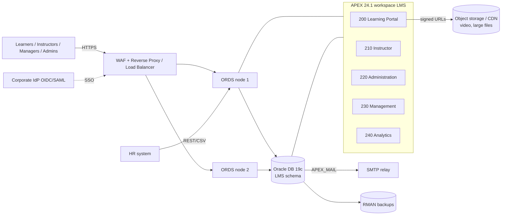
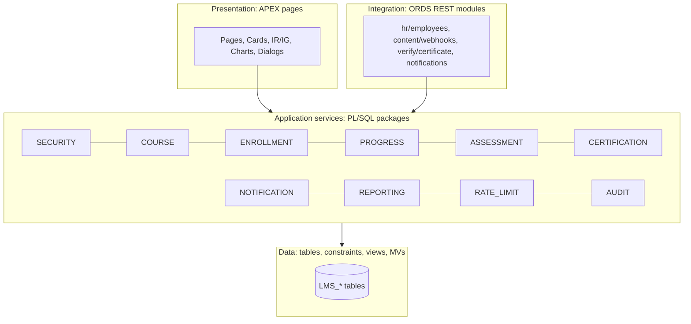
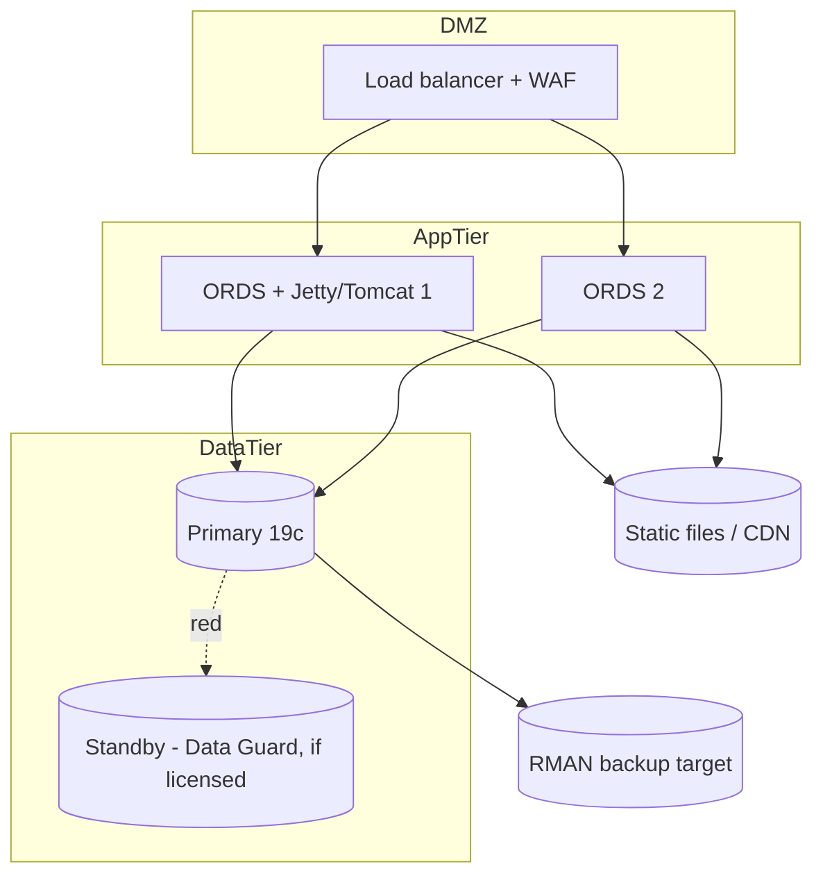
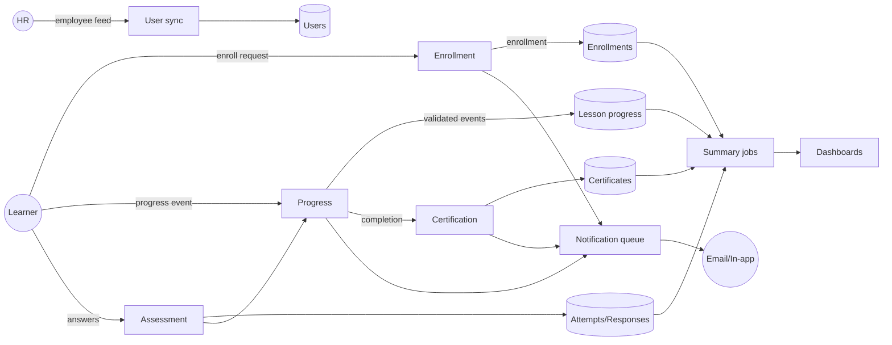
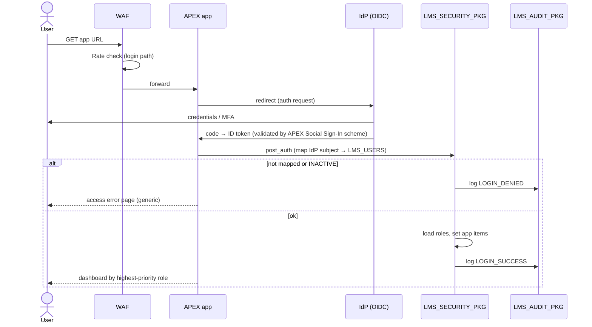
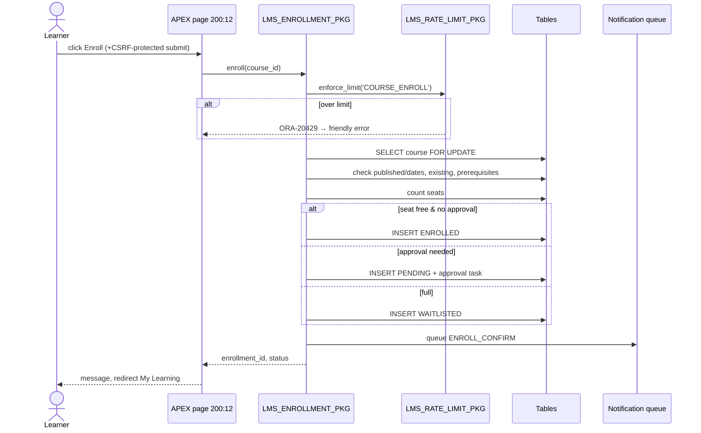
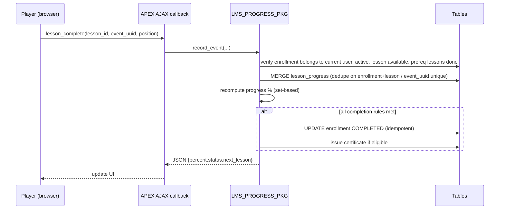

# 02 — System Architecture (Step 3)

All diagrams are Mermaid. Not rendered/validated in this session; paste into a Mermaid live editor to check.

## 1. High-level solution architecture

## 2. Component responsibilities

| Component | Responsibility | Interacts with |
|---|---|---|
| WAF / reverse proxy | TLS termination, coarse rate limits, bot rules, header sanitising (sets trusted `X-Forwarded-For`) | ORDS |
| ORDS (≥ 2 nodes) | Serve APEX and REST modules; JDBC pool per node | DB |
| APEX apps | UI, validation UX, calling packages | Packages |
| `LMS_SECURITY_PKG` | Current user resolution, permission checks, row visibility | all packages |
| `LMS_COURSE_PKG` | Course lifecycle, approvals | security, audit |
| `LMS_ENROLLMENT_PKG` | Eligibility, capacity, waitlist, approval | rate limit, notification |
| `LMS_PROGRESS_PKG` | Event ingest, dedupe, % and completion | enrollment, certification |
| `LMS_ASSESSMENT_PKG` | Attempts, grading, answer protection | progress |
| `LMS_CERTIFICATION_PKG` | Issue/verify/revoke/renew | notification |
| `LMS_NOTIFICATION_PKG` | Queue, render templates, send, retry | `APEX_MAIL` |
| `LMS_RATE_LIMIT_PKG` | Atomic quota decisions | security events |
| `LMS_AUDIT_PKG` | Append-only audit and security events (autonomous) | all |
| `LMS_REPORTING_PKG` + MVs/summary tables | Dashboard data | scheduler |
| DBMS_SCHEDULER jobs | Notifications, reminders, summary refresh, cleanup, expiry | packages |

## 3. Logical application architecture

Rules: pages never write to tables directly except trivial maintenance forms on lookup tables; every other DML goes through a package. Packages never `COMMIT` (exception: autonomous audit/rate-limit/queue procedures). The APEX page process owns the transaction.

## 4. Deployment architecture

Environments: DEV → TEST → UAT → PROD, each with its own schema, ORDS and workspace; same scripts, different `LMS_SYSTEM_SETTINGS` and credentials (never in source).

## 5. Data-flow diagram (level 1)

## 6. Authentication sequence

Fallback (dev/local or house scheme): `AUTH.Pkg_Security.Authenticate_User_` verifies the user and `AUTH.AUTHS` grant, then the LMS post-auth procedure above maps the username to `LMS_USERS`. Doc 06 §6 lists required hardening before reuse.

## 7. Course-enrollment sequence

## 8. Learning-progress update sequence

## 9. Rate-limiting architecture
See doc 06 §3 (diagram and policy table).
