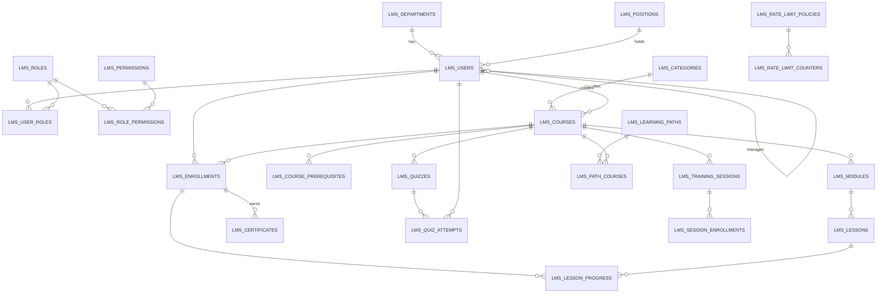
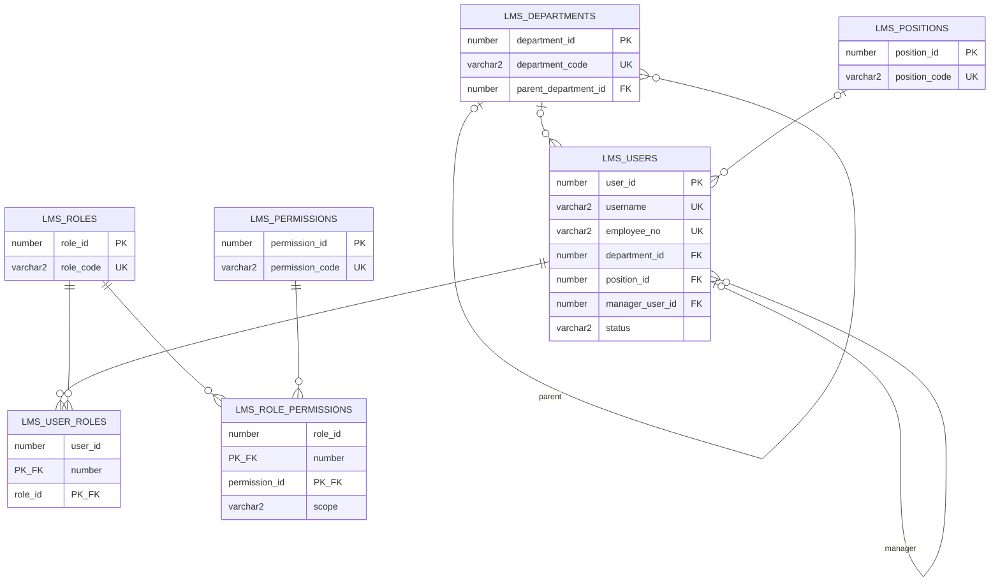
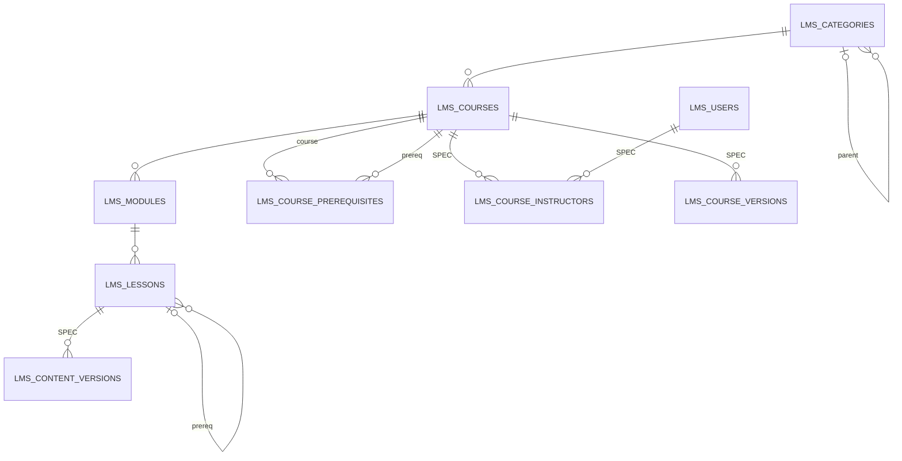
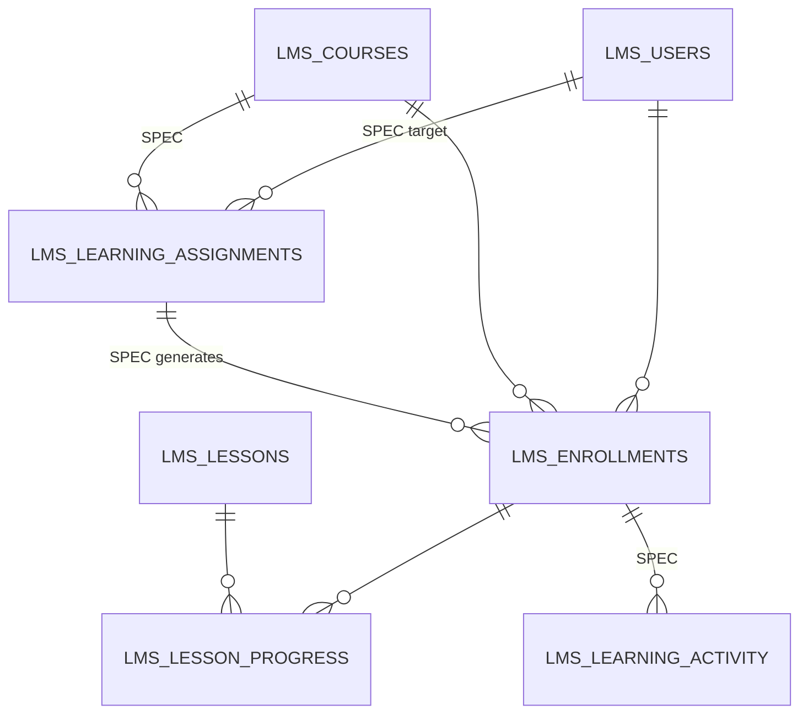
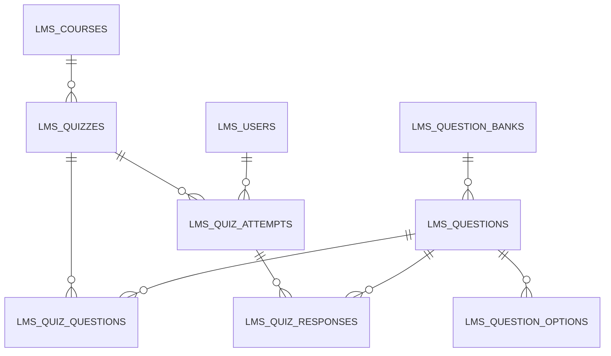
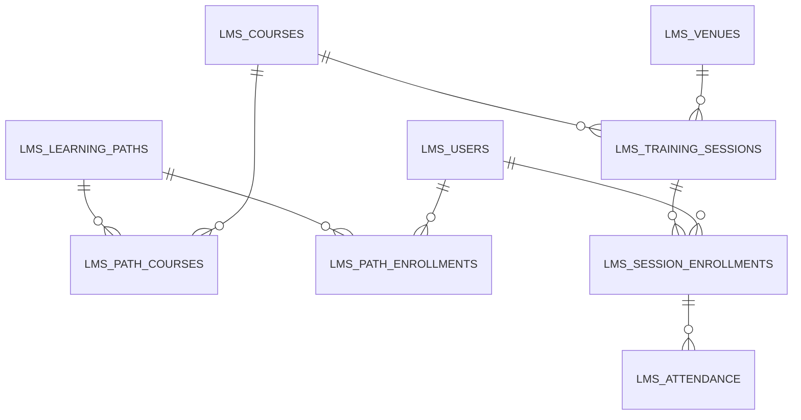
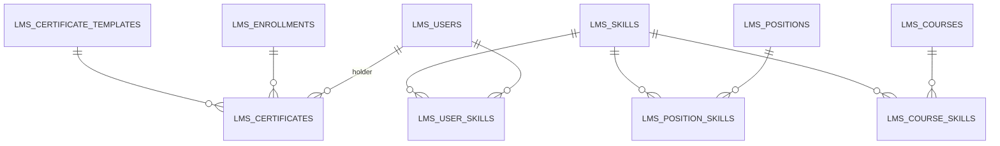
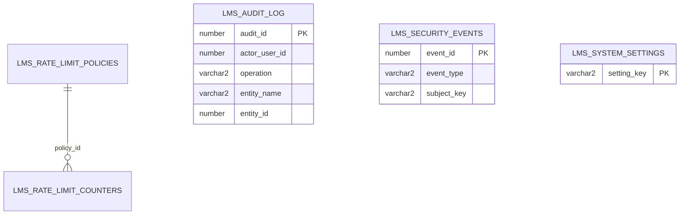

# 03 — Database Design (Steps 4 & 5)

DDL status: **all tables in this document now have DDL** in `02_DATABASE/01_core_schema.sql` and `03_remaining_tables.sql` (written, not executed against Oracle). The **[SPEC]** tags below are historical: the DDL exists, but the ERD diagrams have **not yet been re-reconciled line by line** with it. Known differences are listed in section 5 ("Changes made while writing the DDL"); treat the DDL as authoritative.

## 1. Integrated high-level ERD

## 2. Module ERDs

### 2.1 Identity and organization [DDL]

Note: the prompt's `LMS_USER_MANAGERS` is **not** created. A single `MANAGER_USER_ID` suffices for a tree; add `LMS_USER_MANAGERS` (matrix/dotted-line managers) only if the organisation requires multiple managers (open question OQ-3).

### 2.2 Learning catalog [DDL except instructors, versions, content versions]

### 2.3 Enrollment and progress [DDL; LEARNING_ACTIVITY, ASSIGNMENTS SPEC]

### 2.4 Assessments [SPEC]

Added table `LMS_QUESTION_BANKS` (required by "question banks", missing from prompt inventory).

### 2.5 Learning paths, sessions [SPEC]

Added `LMS_VENUES`. Attendance is per session enrollment (and per session day if multi-day: `LMS_ATTENDANCE(session_enrollment_id, session_day)`).

### 2.6 Certifications and skills [SPEC]

Skill-gap path: Employee → Position → `LMS_POSITION_SKILLS.required_level` vs `LMS_USER_SKILLS.current_level` → `LMS_COURSE_SKILLS` → recommended courses.

### 2.7 Security and monitoring [DDL]

`LMS_AUDIT_LOG.ACTOR_USER_ID` and `LMS_SECURITY_EVENTS.USER_ID` intentionally have **no FK** (audit must survive user changes and record unknown actors).

## 3. Data dictionary

Conventions: PK `<entity>_id` identity; FK columns indexed; `*_FLAG` = `CHAR(1)` `'Y'/'N'`; event times `TIMESTAMP WITH TIME ZONE`, business dates `DATE`; `ROW_VERSION` for optimistic locking on edited entities. Growth figures use the doc 01 assumptions (10k users, 5k courses, 100k enrollments, 1M activity rows).

### 3.1 Implemented tables [DDL] — full column detail is in the SQL file; summary:

| Table | Purpose | PK | FKs | Unique / check highlights | Indexes (beyond PK/UK) | Growth / retention |
|---|---|---|---|---|---|---|
| LMS_DEPARTMENTS | Org hierarchy | department_id | parent→self | code UK; parent≠self | parent | ~500 rows; permanent |
| LMS_POSITIONS | Job titles | position_id | — | code UK | — | ~1k; permanent |
| LMS_USERS | Employee/user profile | user_id | dept, position, manager→self | username UK & = UPPER(TRIM); empno UK; status IN; manager≠self | dept, position, manager | 10k; deactivate, never delete |
| LMS_ROLES / LMS_PERMISSIONS | RBAC catalogs | id | — | code UK | — | <100 |
| LMS_ROLE_PERMISSIONS | Role→permission with scope | (role_id, permission_id) | both | scope IN (ALL,TEAM,OWN,ASSIGNED) | permission_id | <500 |
| LMS_USER_ROLES | User→role | (user_id, role_id) | user, role, granted_by | — | role_id | ~20k |
| LMS_CATEGORIES | Configurable categories | category_id | parent→self | active IN | parent | <200 |
| LMS_COURSES | Course master | course_id | category, creator | code UK; status/delivery/difficulty/rule IN; capacity>0; dates order | (category,status), (status,published_at), creator | 5k |
| LMS_COURSE_PREREQUISITES | Course prerequisites | (course, prereq) | both→courses | course≠prereq | prereq_course_id | 10k. Cycles must be prevented in `LMS_COURSE_PKG` (not expressible as a check) |
| LMS_MODULES | Course sections | module_id | course | (course, sort_order) UK | via UK | 25k |
| LMS_LESSONS | Lessons | lesson_id | module, prereq lesson→self | (module, sort_order) UK; type IN | prereq | 150k |
| LMS_ENROLLMENTS | User↔course enrollment | enrollment_id | user, course, assigned_by | **partial unique** active (user,course); status/type IN; pct 0–100 | (user,status), (course,status), (due_date,status), assigned_by | 100k; keep 10 y |
| LMS_LESSON_PROGRESS | Per-lesson state | progress_id | enrollment, lesson | (enrollment, lesson) UK dedupes events | lesson_id | up to ~1.5M; keep with enrollment |
| LMS_SYSTEM_SETTINGS | Config key/value | setting_key | — | — | — | <200 |
| LMS_AUDIT_LOG | Append-only audit | audit_id | none (by design) | result IN; metadata IS JSON | time; (entity,id,time); (actor,time) | ~2–5M/yr; 7 y (setting); candidate for interval partitioning if licensed |
| LMS_SECURITY_EVENTS | Violations, failures | event_id | none | severity IN | time; (type,time) | ~1M/yr; 2 y |
| LMS_RATE_LIMIT_POLICIES | Per-operation limits | policy_id | — | operation UK; count>0; window 1–86400; fail_mode IN | — | <50 |
| LMS_RATE_LIMIT_COUNTERS | Windowed counters | counter_id | policy | UK (policy, subject, window_start) | expires_at | transient; purge every 15 min |

Deviation from prompt: `LMS_RATE_LIMIT_POLICIES` adds `FAIL_MODE` (required by "fail-open vs fail-closed per operation"); `LMS_RATE_LIMIT_COUNTERS.WINDOW_START` is epoch seconds (`NUMBER`) rather than a timestamp to make atomic window alignment trivial. `LMS_API_REQUEST_LOG` is deferred (see 3.2).

### 3.2 Designed tables [SPEC] (DDL outstanding)

| Table | Purpose | Key columns | Notable constraints / indexes |
|---|---|---|---|
| LMS_COURSE_INSTRUCTORS | Instructors assigned to course | (course_id, user_id), role (LEAD/ASSISTANT) | idx user_id |
| LMS_COURSE_VERSIONS | Snapshot at publish | course_id, version_no, snapshot_json (CLOB IS JSON), published_by | UK(course_id,version_no) |
| LMS_CONTENT_VERSIONS | Lesson content revisions | lesson_id, version_no, content_ref/text, created_by | UK(lesson_id,version_no) |
| LMS_LESSON_CONTENT | File metadata (ref, mime, size, checksum, storage_type EXT/BLOB, optional BLOB ≤25 MB) | lesson_id | check size ≤ limit when BLOB; **BLOB tablespace separate**, SecureFiles |
| LMS_LEARNING_ACTIVITY | Append-only event log (view, start, complete, quiz) | enrollment_id, event_type, event_time, event_uuid | UK event_uuid; idx (enrollment, event_time); interval-partition by month if licensed; 1M+ rows |
| LMS_LEARNING_ASSIGNMENTS | Mandatory/rule assignment header | course_id/path_id, target (USER/DEPT/POSITION), due_date, created_by | generates enrollments set-based |
| LMS_QUESTION_BANKS, LMS_QUESTIONS, LMS_QUESTION_OPTIONS | Question pool; options carry `IS_CORRECT` | question_type IN (MCQ,MULTI,TF,MATCH,SHORT,ESSAY) | `IS_CORRECT` column privilege: no APEX/learner schema select; read only via assessment pkg or view excluding it |
| LMS_QUIZZES | Quiz settings | course_id/lesson_id, pass_score, time_limit_min, max_attempts, randomise_q/a, available_from/to | check pass 0–100 |
| LMS_QUIZ_QUESTIONS | Quiz↔question (fixed or random pick rule) | UK(quiz, question) | |
| LMS_QUIZ_ATTEMPTS | Attempt header | quiz_id, user_id, attempt_no, started_at, deadline_at (server computed), submitted_at, score, status | UK(quiz,user,attempt_no); attempt_no ≤ max enforced in pkg + unique |
| LMS_QUIZ_RESPONSES | Answers | attempt_id, question_id, answer_json, points | UK(attempt,question) |
| LMS_LEARNING_PATHS, LMS_PATH_COURSES, LMS_PATH_ENROLLMENTS | Paths | sequence_no; status | UK(path, sequence_no); UK active (user, path) like enrollments |
| LMS_VENUES, LMS_TRAINING_SESSIONS, LMS_SESSION_ENROLLMENTS, LMS_ATTENDANCE | Instructor-led | start_ts, end_ts (TSTZ), seats, meeting_url, status; attendance status P/A/L | check end>start; seat logic same lock pattern as courses |
| LMS_CERTIFICATE_TEMPLATES, LMS_CERTIFICATES | Certs | certificate_no UK, verification_code UK (random), issued_at, expires_at, status (VALID/REVOKED/EXPIRED), revoked_reason | UK(enrollment_id, template_id, cycle_no) = idempotent issue; idx expires_at |
| LMS_SKILLS, LMS_POSITION_SKILLS, LMS_USER_SKILLS, LMS_COURSE_SKILLS | Skills | levels 1–5 | UK pairs |
| LMS_COURSE_REVIEWS, LMS_FEEDBACK_FORMS/QUESTIONS/RESPONSES | Feedback | rating 1–5 | UK(enrollment_id) for one review per completion |
| LMS_NOTIFICATION_TEMPLATES, LMS_NOTIFICATIONS, LMS_NOTIFICATION_QUEUE | Messaging | template_code, lang, subject/body (placeholders); queue: status, attempts, next_attempt_at, last_error | idx (status, next_attempt_at); purge sent after 90 d |
| LMS_API_REQUEST_LOG | ORDS/API calls | route, status, duration, subject hash | monthly interval partition if licensed else 90-day purge |
| LMS_APPROVALS (added) | Approval requests (enrollment/course) | request_type, entity_id, requester, approver, status, due_at, escalated_to | idx (approver, status), (due_at) — unless APEX 24.1 Approvals component is used as the engine (see doc 05 decision) |
| LMS_SUMMARY_* (added) | Pre-aggregated dashboard tables | e.g. LMS_SUM_DEPT_DAILY(dept_id, day, enrollments, completions, hours) | refreshed by job |

### 3.3 Storage recommendation (module 4)
| Content | Where | Why |
|---|---|---|
| Video | External object storage/CDN or streaming platform; DB holds `content_ref` and per-request signed URL generated server-side after authorisation | 500 concurrent viewers × ~2–5 Mbps ≈ 1–2.5 Gbps would saturate ORDS/DB; backup size explosion |
| PDF/PPT/docs ≤ 25 MB | Either: SecureFiles BLOB (simple backup, transactional, authorised via APEX download process) or object store | BLOB acceptable for modest volume (e.g. 5,000 courses × 5 MB = 25 GB); choose external if >200 GB expected |
| Thumbnails, certificate PDFs | Certificate PDFs generated on demand and optionally cached as BLOB (small) | |

## 4. Index strategy (access-pattern based)
| Access pattern | Index |
|---|---|
| My Learning (user's enrollments by status) | `LMS_ENR_USER_STATUS_IX` |
| Course roster / capacity count | `LMS_ENR_COURSE_STATUS_IX` |
| Mandatory-deadline monitoring | `LMS_ENR_DUE_IX` |
| Duplicate prevention | `LMS_ENR_ACTIVE_UK` (function-based unique) |
| Catalog by category/status | `LMS_CRS_CAT_STATUS_IX`; recently added via `LMS_CRS_STATUS_PUB_IX` |
| Lesson progress lookups | UK `(enrollment_id, lesson_id)` serves; `lesson_id` index supports FK/deletes |
| Certificate expiry sweep | `(status, expires_at)` on LMS_CERTIFICATES [SPEC] |
| Manager subtree | `LMS_USR_MGR_IX` |
Impact: each index adds write cost; hottest write tables are LMS_LESSON_PROGRESS and LMS_ENROLLMENTS, so they carry only the indexes above. Verify with `DBMS_XPLAN.DISPLAY_CURSOR(format=>'ALLSTATS LAST')` after load tests; drop unused indexes found via `DBA_INDEX_USAGE`/monitoring (19c: `V$OBJECT_USAGE` with `ALTER INDEX ... MONITORING USAGE`).

## 5. Changes made while writing the DDL (DDL is authoritative)
| Area | Change |
|---|---|
| `LMS_ENR_ACTIVE_UK` | Excludes `COMPLETED` as well as CANCELLED/FAILED/EXPIRED so a renewal cycle can start; re-taking is policed in `LMS_ENROLLMENT_PKG` |
| `LMS_ENROLLMENTS` | + `INSTRUCTOR_APPROVED_FLAG` (completion rule INSTRUCTOR_APPROVAL) |
| `LMS_COURSES` | + `CERTIFICATE_TEMPLATE_ID` (FK), `FEEDBACK_FORM_ID` (FK) |
| `LMS_LEARNING_PATHS` | + `CERTIFICATE_TEMPLATE_ID` (FK) |
| `LMS_CERTIFICATES` | Course **or** path source (`ENROLLMENT_ID` xor `PATH_ENROLLMENT_ID`), snapshot titles, no `CYCLE_NO` (a renewal is a new enrollment); idempotency by function-based unique indexes |
| `LMS_APPROVALS` | Implemented as a table (not APEX's Approvals component) so the same rules run from PL/SQL, jobs and APEX; one open request per entity (unique index) |
| `LMS_QUESTION_OPTIONS` | `MATCH_KEY` (right-hand side of matching) and accepted answers for SHORT questions; answer data, never exposed by learner views |
| `LMS_QUIZ_ATTEMPTS` | Unique index allowing one `IN_PROGRESS` attempt per quiz+user |
| `LMS_QUIZ_RESPONSES` | Rows are created at attempt start (fixes the random question set); `SORT_ORDER` column |
| `LMS_SUM_*` | Summary tables for dashboards instead of materialised views |
| Not created | `LMS_USER_MANAGERS` (single manager column), `LMS_FEEDBACK_FORMS` attached per course |
