# 04 — Business Process Flows (Step 6)

Each workflow: flowchart + actors, preconditions, main path, alternatives/exceptions, DB operations, outputs. Mermaid not rendered in this session.

## WF-01 User authentication
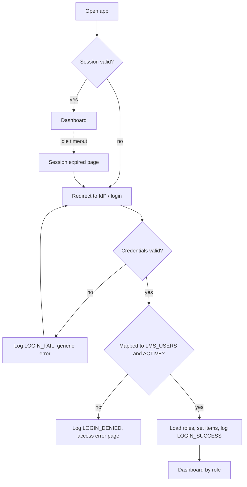
- **Actors:** any user, IdP. **Pre:** user exists/active in LMS_USERS.
- **Alt:** lockout after repeated failures is enforced by the IdP (avoid app-level account lockout → DoS risk); app-level per-IP limiting at WAF.
- **DB:** read LMS_USERS/USER_ROLES; insert LMS_AUDIT_LOG, LMS_SECURITY_EVENTS. **Out:** authenticated session.

## WF-02 Course creation
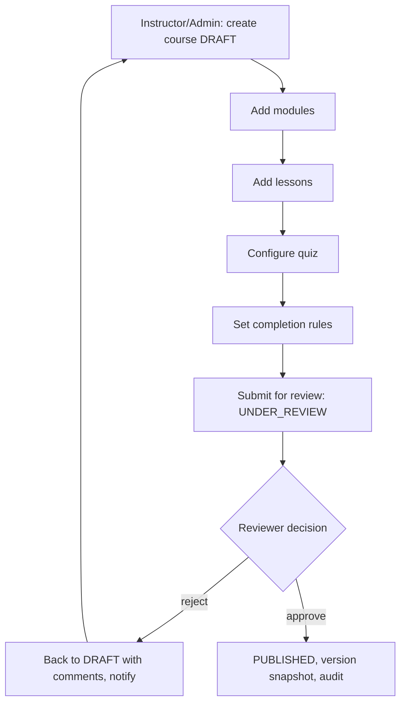
- **Pre:** COURSE_AUTHOR. **Rules:** reviewer ≠ author (SoD); publish requires ≥1 required lesson and valid completion rule.
- **DB:** LMS_COURSES, MODULES, LESSONS, QUIZZES, COURSE_VERSIONS, APPROVALS, AUDIT. **Out:** published course visible in catalog.

## WF-03 Course enrollment
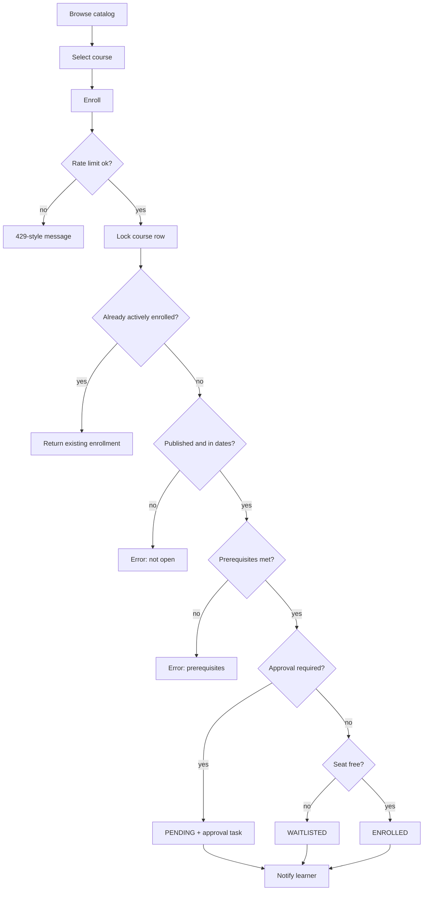
- **DB:** SELECT…FOR UPDATE LMS_COURSES; INSERT LMS_ENROLLMENTS (unique index is backstop); LMS_NOTIFICATION_QUEUE; AUDIT.
- **Exceptions:** `ORA-00001` on `LMS_ENR_ACTIVE_UK` (should be unreachable due to lock) → treat as idempotent success.

## WF-04 Course completion
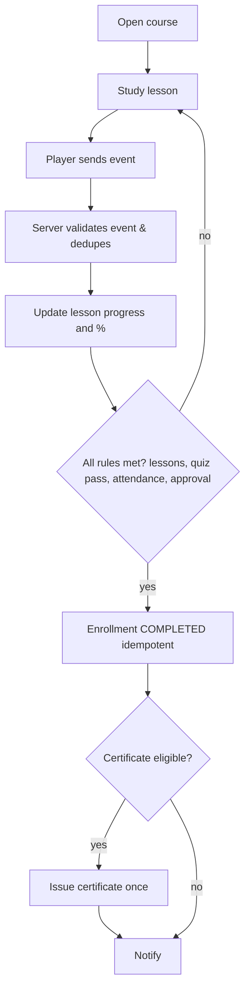
- **Alt:** instructor-approval rule keeps status IN_PROGRESS until approval. **DB:** LESSON_PROGRESS MERGE, ENROLLMENTS update (row_version), CERTIFICATES insert guarded by UK.

## WF-05 Assessment
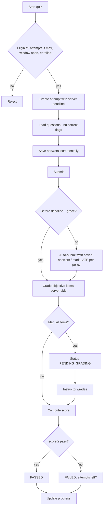
- **Rate limit:** QUIZ_SUBMIT 5/min, fail-closed. **Idempotency:** submit on an already-SUBMITTED attempt returns existing result.

## WF-06 Mandatory learning
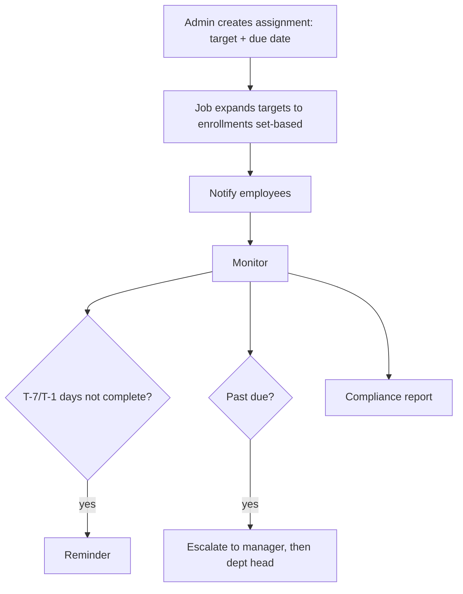
- **DB:** LMS_LEARNING_ASSIGNMENTS, ENROLLMENTS (type MANDATORY), NOTIFICATION_QUEUE; scheduler `LMS_REMINDER_JOB` daily.

## WF-07 Instructor-led training
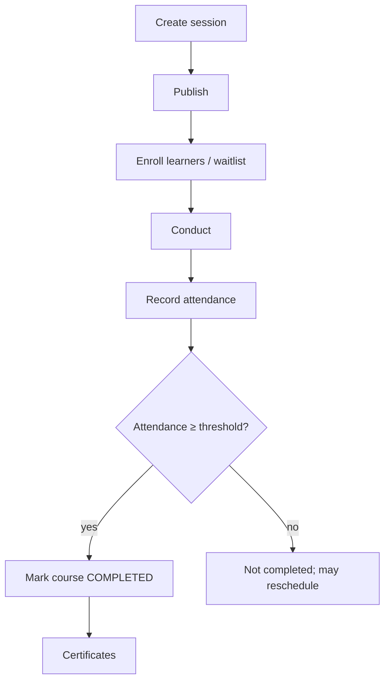
Cancel/reschedule → notify all participants and promote/reflow waitlist.

## WF-08 Certification renewal
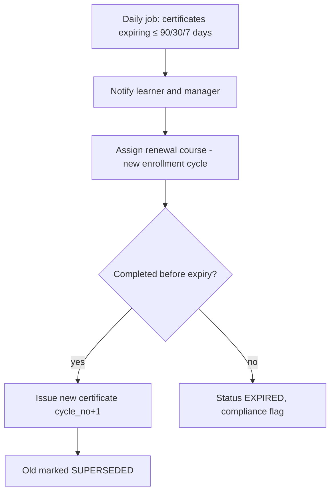

## WF-09 Learning path completion
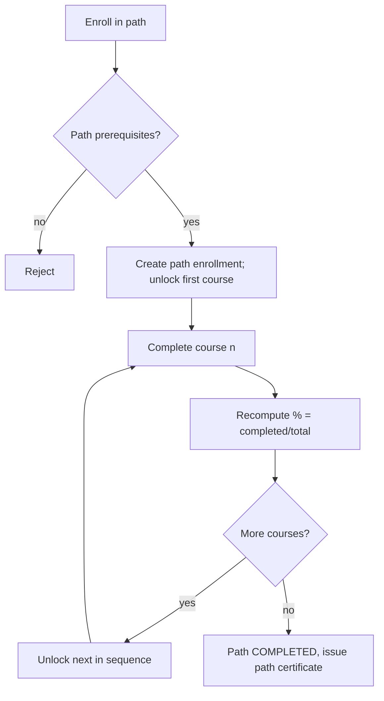

## WF-10 Rate-limit enforcement
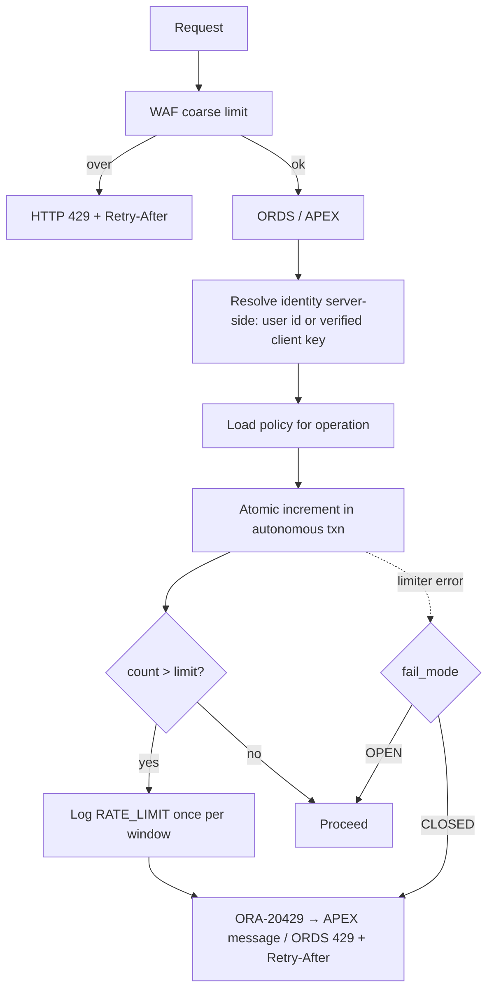

## WF-11 Approval and escalation
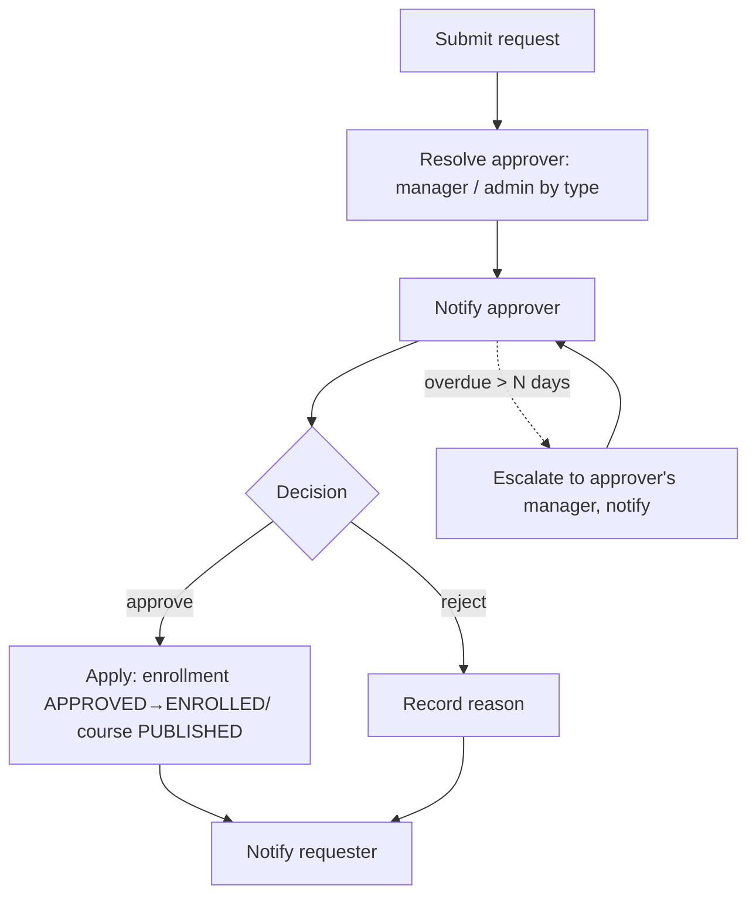
Approver cannot be the requester; delegate approver supported through `LMS_APPROVALS.delegate_user_id`.

### Common database operations summary
All state transitions: row lock → validate → DML → audit (autonomous) → enqueue notification (same transaction) → caller commits. Notification sending is asynchronous by `LMS_NOTIFICATION_PKG.PROCESS_QUEUE` (scheduler every minute, `FOR UPDATE SKIP LOCKED` batches, retry with backoff 1/5/30 min, give up after 5 attempts and log).
