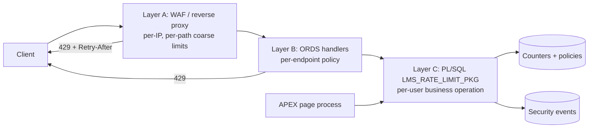

# 06 — Security, Rate Limiting and Performance (Steps 10 & 11)

## 1. Security architecture (defence in depth)

| Layer | Controls |
|---|---|
| Edge | TLS 1.2+ (1.3 preferred), HSTS, WAF OWASP core rules, header normalisation, bot/scrape rules, request size limits |
| Authentication | Production: corporate SSO via OIDC/SAML (APEX *Social Sign-In* or reverse-proxy header scheme — header scheme only if the proxy strips client-supplied identity headers). MFA at the IdP |
| Session | Idle timeout 30 min, max 8 h; session cookie `Secure/HttpOnly/SameSite`; re-auth for admin actions optional; **Session State Protection** on (checksum, level per page); protected app items |
| Authorization | Permission tables → `LMS_SECURITY_PKG`; APEX authorization schemes on pages/regions/buttons/processes **and** `REQUIRE_PERMISSION` inside packages (server-side authority; hidden buttons are cosmetic) |
| Row-level | Views joined to `current_user_id` / manager subtree (`IS_IN_SUBTREE`); optionally Oracle Virtual Private Database (**Enterprise Edition feature**) on `LMS_ENROLLMENTS` for defence in depth — evaluate licence |
| Application | Bind variables only; `APEX_ESCAPE`/column escaping (Escape special characters = Yes on all report columns); HTML lesson content sanitised; CSRF mitigated by APEX session-state checksums + request protection; file upload type/size/magic-byte validation, virus scan on ingestion |
| Data | Least-privilege schema: APEX parsing schema = LMS owner is common but prefer **separate parsing schema** with `EXECUTE` on packages and `SELECT` on views only (tables owned by `LMS_OWNER`); `IS_CORRECT` hidden from non-package access; no PII in URLs; certificate verification limited fields |
| Encryption | In transit TLS (ORDS↔DB over TLS if network untrusted). At rest: TDE (Oracle Advanced Security option, **extra licence on-prem**) or storage-level encryption; backups encrypted (RMAN encryption — Advanced Security for transparent/password modes check licence) |
| Audit | `LMS_AUDIT_LOG`, `LMS_SECURITY_EVENTS` (autonomous writers); no passwords/tokens/answer content; correlation id; DB-level `AUDIT` (unified auditing) for privileged users |
| Secrets | Wallets / ORDS credential store / environment variables; never in SQL scripts or APEX static files |

### Sensitive-data classification
| Class | Examples | Handling |
|---|---|---|
| Restricted | Quiz correct answers, SSO tokens, SMTP credentials | Package-only access / vault |
| Confidential | Names, emails, employee no., scores, certificates, org structure | Role/row restricted, masked in exports for non-authorised |
| Internal | Course catalog, policies | Authenticated |
| Public | Certificate verification result (minimal) | Rate-limited, no PII beyond configured display name/initials |

### Authorization objects
- Tables: `LMS_ROLES`, `LMS_PERMISSIONS`, `LMS_ROLE_PERMISSIONS`, `LMS_USER_ROLES` (DDL provided).
- PL/SQL: `LMS_SECURITY_PKG.CURRENT_USER_ID / HAS_PERMISSION / REQUIRE_PERMISSION / IS_IN_SUBTREE` (provided).
- APEX scheme example (Shared Components → Authorization Schemes → Create → *PL/SQL Function Returning Boolean*): `RETURN lms_security_pkg.has_permission('COURSE_AUTHOR');` — Evaluation point: *Once per session* for static role checks; *Once per page view* for data-dependent ones.

### Seed permission codes (for `18_seed_data.sql`, to be written)
`CATALOG_VIEW, ENROLL_SELF, ENROLL_ASSIGN, ENROLL_APPROVE, COURSE_AUTHOR, COURSE_PUBLISH, QUIZ_TAKE, QUIZ_AUTHOR, GRADE, SESSION_MANAGE, CERT_VIEW_OWN, CERT_POLICY, CERT_REVOKE, SKILL_MANAGE, REPORT_TEAM, REPORT_ORG, USER_ADMIN, ROLE_ADMIN, SETTINGS_ADMIN, AUDIT_VIEW, RATELIMIT_ADMIN, NOTIF_TEMPLATE_ADMIN` (matrix in doc 01 §2.4).

### Known gap in the supplied package
`LMS_ENROLLMENT_PKG.ASSIGN` uses `HAS_PERMISSION('REPORT_ORG')` as a proxy for "unrestricted scope". That couples two concepts and is a shortcut: replace with the `SCOPE` column of `LMS_ROLE_PERMISSIONS` (`ALL` vs `TEAM`) via a `LMS_SECURITY_PKG.PERMISSION_SCOPE(code)` function. Tracked in doc 08.

## 2. Authentication notes: house `AUTH.Pkg_Security`

If LMS must initially reuse the organisation's existing login package, treat it as a **temporary bridge** and fix the following before production (full list and a hardened replacement shape were supplied with the project's APEX standards):

1. Passwords may be stored in plaintext (`ready_flag = 0`) or single-DES with a hardcoded key — recoverable by anyone who can read source/table. Migrate to salted SHA-256 (or better, delegate to the IdP) via `DBMS_CRYPTO`.
2. Separate "user not found" / "wrong password" / "account disabled" messages enable user enumeration → one generic message.
3. No lockout/throttling of failed logins → use IdP controls; at WAF rate-limit login path (see §3). App-level lockout creates account-DoS risk, so prefer progressive delay + IdP risk-based lockout.
4. `DBMS_OBFUSCATION_TOOLKIT` is deprecated; `''` null-check is dead code; `NUMBER(2)` count overflow; inconsistent case handling; unhandled `NO_DATA_FOUND` on `AUTH.APPS`; hardcoded app/page routing; use of internal `WWV_FLOW_CUSTOM_AUTH_STD` API.
5. LMS-specific: after `AUTHENTICATE_USER_`, `LMS_SECURITY_PKG.CURRENT_USER_ID_SAFE` maps `APP_USER` → `LMS_USERS.USERNAME` (upper-cased, TRIM). A user authenticated but missing in `LMS_USERS` gets *no* permissions (fail closed).

## 3. Rate limiting (Step 10)

### 3.1 Architecture


### 3.2 Layer A — WAF/reverse proxy (examples; pick the product you run)
| Path / traffic | Suggested rule (initial) | Action |
|---|---|---|
| Login / IdP callback | 20 req/min/IP, burst 10 | 429 + `Retry-After: 60`; log |
| Public verify (`/ords/.../verify`) | 30 req/min/IP | 429 |
| `/ords/lms/**` REST | 300 req/min/IP | 429 |
| File/download endpoints | 60 req/min/IP, bandwidth cap | 429 / throttle |
| Whole site | 1,200 req/min/IP, plus scraper UA/behaviour rules | challenge/block |

Nginx sketch (verify against your build): `limit_req_zone $binary_remote_addr zone=login:10m rate=20r/m;` + `limit_req zone=login burst=10 nodelay; limit_req_status 429;` and `add_header Retry-After 60 always;`. Set `real_ip_header X-Forwarded-For; set_real_ip_from <LB CIDR>;` so only the load balancer's header is trusted. **Shared NAT caveat:** corporate users may share one egress IP; set limits per authenticated cookie/user where the WAF supports it, or raise IP limits for known corporate ranges.

### 3.3 Layer B — ORDS
Each REST handler calls `lms_rate_limit_pkg.check_and_record(op, NULL, :client_key, ok, retry)`; if not `ok`: `owa_util.status_line(429,'Too Many Requests'); owa_util.mime_header('application/json'); htp.p('Retry-After: '||retry)` (use `owa_util.http_header_close` order correctly) and a JSON error body, then `RETURN`. `:client_key` = address set by the trusted proxy; do **not** read a raw `X-Forwarded-For` the client can forge — configure ORDS/proxy so only the proxy's value is exposed (a custom header such as `X-LMS-Client-IP` injected by the proxy, which the proxy overwrites on every request).

### 3.4 Layer C — PL/SQL (implemented in `02_packages_...sql`)
Policies seeded: `AUTH_ATTEMPT 5/15 min (fail closed)`, `COURSE_SEARCH 60/min`, `COURSE_ENROLL 10/min`, `PROGRESS_UPDATE 30/min`, `QUIZ_SUBMIT 5/min (closed)`, `CERT_GENERATE 5/h (closed)`, `FILE_DOWNLOAD 30/min`, `ADMIN_WRITE 30/min`. Initial assumptions to tune after load tests.

**Authentication-limit caveat:** a 5/15 min limit keyed by *username* lets an attacker lock out a victim (account DoS). Key authentication attempts by (client address) at the edge, and by username only as a *soft delay* inside the IdP, never a hard lock without unlock path. `AUTH_ATTEMPT` in the table is meant for the local-auth fallback keyed by client key, not by username.

### 3.5 Algorithm comparison
| | Fixed window | Sliding window (log) | Token bucket |
|---|---|---|---|
| Accuracy | Allows up to 2× limit across a window boundary | Exact | Smooth, bursts bounded |
| DB cost | 1 upsert/request | row per request (high) or two-counter approximation | 1 upsert with timestamp math |
| Concurrency | Single atomic `UPDATE … +1` | Needs cleanup of many rows | Needs row lock for read-modify-write |
| Complexity | Low | Medium–High | Medium |

**Recommendation for 19c business-operation limiting:** fixed window with atomic increment (implemented), optionally the *weighted two-window sliding approximation* later (read previous+current counter). For edge/high-volume traffic use the WAF's native limiter (token bucket/leaky bucket), not the database. Avoid per-page-view DB writes: only the operations in the policy table call the limiter.

### 3.6 Concurrency, hot spots, HA
- `UPDATE … SET request_count = request_count + 1 … RETURNING` is atomic under row lock; first insert race handled by unique key + `DUP_VAL_ON_INDEX` retry (see code).
- Autonomous transaction: counters persist even if the business transaction rolls back (attackers can't "retry for free"). It holds a lock only for the duration of one tiny transaction.
- Subject key per user (not per session): opening new sessions or browsers doesn't reset the quota. Anonymous: hashed verified client key.
- Multiple application servers share the same DB counters, so limits are global. RAC: one hot row per (policy, subject, window) is per-user, so contention is low; heavily shared anonymous buckets (`A:UNKNOWN`) could hot-spot — acceptable, they should be rare.
- Counter retention: `expires_at = 2 × window`; purge job every 15 min in batches.
- Fail mode: configurable per policy (`FAIL_MODE`).
- Clock: windows use database time (`SYSTIMESTAMP`), not app servers.

### 3.7 Enforcement examples
```sql
-- APEX page process (before enrollment submit): errors surface via APEX error handling
begin
  lms_enrollment_pkg.enroll_self(:P12_COURSE_ID, :P12_ENROLLMENT_ID, :P12_STATUS);
end;
-- Application Error Handling Function maps ORA-20429 -> Text Message LMS_ERR_RATE_LIMIT
```
```sql
-- ORDS handler pseudo-flow (PL/SQL source of the GET handler)
declare l_ok boolean; l_retry number;
begin
  lms_rate_limit_pkg.check_and_record('COURSE_SEARCH', null, :client_ip_hdr, l_ok, l_retry);
  if not l_ok then
    owa_util.status_line(429, 'Too Many Requests', false);
    owa_util.mime_header('application/json', false);
    htp.p('Retry-After: ' || l_retry);
    owa_util.http_header_close;
    htp.p('{"error":"rate_limited","retry_after":' || l_retry || '}');
    return;
  end if;
  -- ... normal handler ...
end;
```
(ORDS 429 mechanics should be tested; ORDS resource handlers may alternatively set `:status_code := 429` and implicit header bind `:Retry-After` — verify against the installed ORDS version.)

### 3.8 Monitoring queries
```sql
-- Top violators last hour
select subject_key, operation, count(*) violations
  from lms_security_events
 where event_type='RATE_LIMIT' and event_time > systimestamp - interval '1' hour
 group by subject_key, operation order by violations desc fetch first 20 rows only;

-- Counter table health
select count(*) live_rows, min(expires_at) oldest_expiry from lms_rate_limit_counters;
```

### 3.9 Tests (also in doc 07)
Below/at/above threshold, window rollover, N parallel sessions (e.g. 20 sqlplus sessions or `DBMS_SCHEDULER` jobs) verifying `count = limit` exactly accepted, multiple app servers, anonymous vs authenticated, different operations isolated, cleanup, limiter failure by revoking table privilege (`fail_mode` behaviour), and rejected enrollment leaves no `LMS_ENROLLMENTS` row. Performance impact estimate: one indexed update per limited call ≈ sub-millisecond at low contention; at 30 limited req/s total → trivial redo volume. Measure in load test.

## 4. Performance (Step 11)

### 4.1 SQL practice with examples
| Inefficient | Better | Why |
|---|---|---|
| `where to_char(enrolled_at,'YYYY')='2026'` | `where enrolled_at >= date '2026-01-01' and enrolled_at < date '2027-01-01'` | index-friendly (no function on column) |
| `select distinct c.* from courses c join enrollments e …` | `select c.* from courses c where exists (select 1 from enrollments e where e.course_id=c.course_id and …)` | avoids sort/dup |
| `select *` in report | explicit columns | less I/O, stable plans |
| per-row function calling a query in report SELECT | join to a summary view | avoids N+1 |
| `where upper(username)=upper(:u)` | store `USERNAME` upper-cased, compare `= upper(:u)` on bind only | uses unique index |

### 4.2 Execution plans
```sql
select /*+ gather_plan_statistics */ ... ;  -- run the query
select * from table(dbms_xplan.display_cursor(null, null, 'ALLSTATS LAST'));
-- or by sql_id:
select * from table(dbms_xplan.display_cursor('&sql_id', null, 'ALLSTATS LAST +PEEKED_BINDS'));
```
Read: compare `E-Rows` vs `A-Rows` (cardinality misestimates), `Buffers` (logical reads), `TABLE ACCESS FULL` on big tables, `HASH JOIN` build-side size, `SORT` operations spilling (`OMem/1Mem/Used-Tmp`).

### 4.3 Statistics
Rely on the automatic stats job; after bulk loads/HR sync run `dbms_stats.gather_table_stats(user,'LMS_ENROLLMENTS', cascade=>true, method_opt=>'for all columns size auto')`; lock stats on volatile counter table or gather after peak (`LMS_RATE_LIMIT_COUNTERS` is tiny, delete-heavy); set `dbms_stats` preferences (`INCREMENTAL` for partitioned tables); detect regressions via AWR/ASH (Diagnostics Pack licence) or free alternatives: `V$SQL`, Statspack, SQL Plan Baselines (`DBMS_SPM`, EE) if regressions occur.

### 4.4 Partitioning (only if licensed and justified)
Candidates: `LMS_AUDIT_LOG`, `LMS_LEARNING_ACTIVITY`, `LMS_API_REQUEST_LOG`, `LMS_SECURITY_EVENTS` — **interval partitioning by month** to drop old partitions instantly. Requires **Enterprise Edition + Partitioning option**. Without it, use batched `DELETE` by date in a scheduler job (index on time column provided) — acceptable at the stated volumes (a few million rows/year).

### 4.5 Reporting performance
Dashboards read `LMS_SUM_*` tables populated by `LMS_REPORTING_PKG.REFRESH_SUMMARIES` (job hourly; KPI labelled with last-refresh time) rather than materialised views with complete refresh. Fast-refresh MVs need MV logs on hot tables (write overhead) — only for `LMS_ENROLLMENTS` summary if proven necessary. Trade-off: hourly freshness vs. load.

### 4.6 Background processing
`DBMS_SCHEDULER` jobs: `LMS_NOTIF_JOB` (1 min), `LMS_REMINDER_JOB` (daily), `LMS_CERT_EXPIRY_JOB` (daily), `LMS_SUMMARY_JOB` (hourly), `LMS_AUDIT_PURGE_JOB` (daily), `LMS_RL_PURGE_JOB` (15 min), `LMS_HR_SYNC_JOB` (nightly). APEX 24.1 also offers **Automations** (`APEX_AUTOMATION`, scheduled/polling SQL actions) and background-execution of page processes; use Automations for admin-visible schedules, scheduler for system jobs. Confirm feature availability in your 24.1 build before relying on it.

### 4.7 APEX performance checklist
Cards/IR with pagination (≤ 50 rows); Lazy Loading on dashboard regions; Server-side conditions instead of client hide; avoid "Refresh" DAs on multiple regions simultaneously; static files versioned (`#APP_FILES#app#MIN#.css`) and cached; stable LOVs cached; avoid collections except for the quiz-draft case (prefer table rows keyed by attempt); `Page Zero` kept light; no unnecessary JS libraries.

## 5. Scalability and capacity

| | Small | Medium (assumed baseline) | Large |
|---|---|---|---|
| Registered users | 2,000 | 10,000 | 50,000 |
| DAU / concurrent active | 400 / 100 | 2,000 / 500 | 10,000 / 2,500 |
| Courses / enrollments | 500 / 20k | 5,000 / 100k | 20,000 / 1M |
| Activity rows | 200k | 1M | 20M (partition) |
| DB storage (structured) est. | ~5 GB | ~30 GB | ~250 GB |
| Attachments | 50 GB | 250 GB | 2 TB (object store) |
| Video bandwidth peak | ~100 Mbps | ~1–2 Gbps (CDN) | ~5+ Gbps (CDN) |
| ORDS nodes / JDBC pool per node | 1 / 20 | 2 / 30–40 | 4+ / 40–60 |
| DB | 4 vCPU/16 GB | 8–16 vCPU/64 GB | RAC or large single-node + Data Guard |

These are **order-of-magnitude estimates** needing validation by load tests; concurrent *active* users ≠ DB sessions: with typical 3–5 s think time and ~100–300 ms DB time per request, 500 users need on the order of 30–80 concurrent DB sessions, so pool sizes above are conservative. Scaling: stateless ORDS behind load balancer (APEX session state is in the DB, so no sticky sessions needed), read-heavy dashboards from summary tables or an Active Data Guard standby (extra licence), asynchronous notification and certificate generation, CDN for video, connection pool tuning (ORDS `jdbc.InitialLimit/MinLimit/MaxLimit`).
